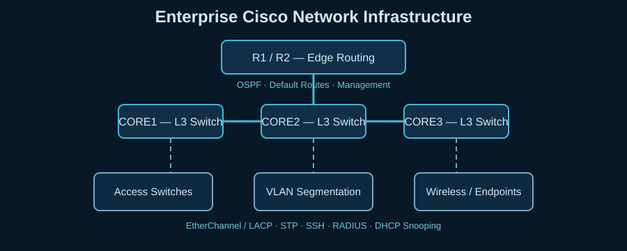
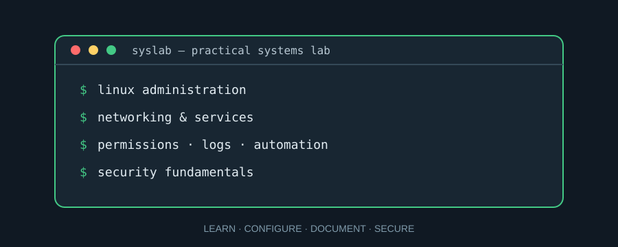

# Hi, I'm Adrià Julián   Cybersecurity, Networks & IT Infrastructure

**Cybersecurity-focused ASIR student | Network and IT support experience | Blue Team laboratories**

I build defensive-security and network laboratories focused on monitoring, incident analysis, firewalling, segmentation, traffic analysis, Linux systems, and Python automation. My IT-support experience provides a practical foundation in connectivity, VPN, Wi-Fi, firewalling, switches, and troubleshooting.

Primary interest: **cybersecurity and blue team / SOC roles**. Secondary focus: **network security and IT infrastructure**.

---

## Featured Projects

Hands-on work across **cybersecurity, network infrastructure, and systems administration**. Each card links directly to a public project.

<table>
  <tbody>
    <tr>
      <td width="28%" align="center" valign="middle">
        
      </td>
      <td valign="top">
        <h3>SentinelScan</h3>
        
<strong>What it does:</strong> Performs authorized TCP/UDP checks and correlates captured service banners with a local educational vulnerability database.

        
<strong>Highlights:</strong> IPv4/IPv6 resolution · concurrency controls · TXT/JSON/CSV/HTML reports · Windows CI.

        
<code>Python</code> <code>asyncio</code> <code>sockets</code> <code>Rich</code>

        
        
For systems you own or are explicitly authorized to test.

      </td>
    </tr>
  </tbody>
</table>

 

<table>
  <tbody>
    <tr>
      <td width="28%" align="center" valign="middle">
        
      </td>
      <td valign="top">
        <h3>CyberShield Encryptor</h3>
        
<strong>What it does:</strong> Analyzes password characteristics and encrypts text or files with authenticated AES-GCM.

        
<strong>Highlights:</strong> PBKDF2 key derivation · AES-128/256 · English/Spanish GUI · CLI · file overwrite protection · automated tests.

        
<code>Python</code> <code>AES-GCM</code> <code>PBKDF2</code> <code>GUI + CLI</code>

        
      </td>
    </tr>
  </tbody>
</table>

 

<table>
  <tbody>
    <tr>
      <td width="28%" align="center" valign="middle">
        
      </td>
      <td valign="top">
        <h3>Enterprise Network Lab</h3>
        
<strong>What it does:</strong> Documents a redundant, segmented Cisco enterprise network with a three-switch core and access layer.

        
<strong>Highlights:</strong> VLANs/SVIs · OSPF · EtherChannel/LACP · STP · SSH/RADIUS · DHCP Snooping.

        
<code>Cisco IOS</code> <code>Routing</code> <code>Switching</code> <code>Network Security</code>

        
      </td>
    </tr>
  </tbody>
</table>

 

<table>
  <tbody>
    <tr>
      <td width="28%" align="center" valign="middle">
        
      </td>
      <td valign="top">
        <h3>SysLab</h3>
        
<strong>What it does:</strong> A practical learning lab for Linux administration, networking, services, permissions, logs, and security.

        
<code>Linux</code> <code>Bash</code> <code>Networking</code> <code>Systems Administration</code>

        
      </td>
    </tr>
  </tbody>
</table>

> **Academic project in development:** PROYECTO INTERMODULAR covers networking, identity, web, database, and security services. Its repository is not publicly accessible yet, so it is not shown with a broken or private-project button.

---

## Core Technical Skills

### Systems and Networks

### Security and Development

**Primary areas:** Wazuh SIEM · incident and log analysis · network traffic analysis · firewall and VPN security · VLAN segmentation · defensive laboratories · threat detection · Python automation

**Supporting areas:** FortiGate/Sophos policies · UniFi Wi-Fi · switching and routing · Linux/Windows administration · VMware/Proxmox virtualisation · Wireshark, Nmap, Metasploit and Burp Suite · Elastic · SQL databases

---

## Practical Experience

### Network Technician — Internship

**November 2025 – June 2026**

- Diagnosed and tracked user, connectivity, and network incidents for multiple customers.
- Supported the review and configuration of Fortinet FortiGate security policies.
- Assisted with UniFi and Fortinet access points and Wi-Fi segmentation.
- Supported VPN IPsec/SSL configuration and remote-access connectivity checks.
- Assisted with switch configuration and basic routing reviews.
- Contributed to firewall, VLAN, Wi-Fi, and continuity troubleshooting.

---

## Certifications

- Cisco — CCST Cybersecurity
- Fortinet — Cybersecurity Associate
- Cisco — CCST Networking
- Cisco — CCST IT Support
- Microsoft — MOS Excel Expert 2019
- Microsoft — MOS Word Expert 2019
- Microsoft — MOS Access Expert 2019
- Pearson — IT Specialist: Device & Management
- AWS — Application Networking Demonstrated
- Fortinet — Cybersecurity Fundamentals

Verified credential profile: [Credly](https://www.credly.com/users/adria-julian)

---

## Training

- **Cybersecurity and Ethical Hacking Course** — BIG school — March 2026
- **Python Essentials 2** — Cisco Networking Academy — January 2026
- **Python Fundamentals 1** — Cisco Networking Academy — December 2025

Formal education:

- **CFGS ASIR with cybersecurity profile** — CEV — 2025 to present
- **CFGM Computer Systems and Networks** — CEV — 2023 to 2025

---

## Labs and Platforms

- **Hack The Box:** controlled offensive labs, enumeration, foothold, privilege escalation, and post-exploitation.
- **TryHackMe:** guided labs for networks, Linux, and offensive security.
- **CyberDefenders:** incident analysis, DFIR, forensics, and threat detection.

---

## GitHub Activity

---

## Career Objective

Entry-level opportunities in **SOC/blue team operations, security analysis, incident analysis, network security, or cybersecurity support**.

I am developing practical skills in log and alert analysis, incident investigation, network segmentation, firewall configuration, traffic analysis, security documentation, automation, and incident response through controlled laboratories.

## Professional Profiles

- **GitHub:** [github.com/AJulianSec](https://github.com/AJulianSec)
